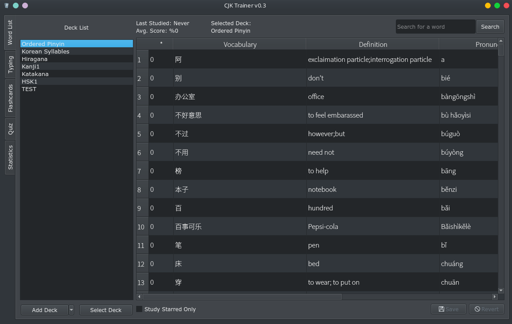
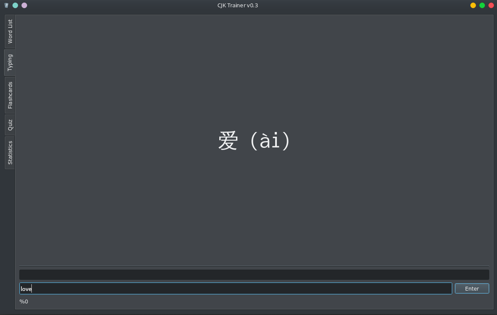
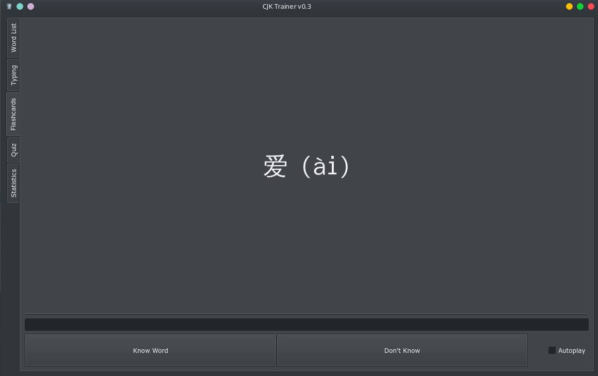

# CJK Trainer

A desktop flashcard app for learning Chinese, Japanese and Korean vocabulary, built with Python, PyQt5 and SQLite. Runs on Windows, macOS and Linux.

> **This is the prototype that became [WordFarm](https://wordfarm.app).** I built CJK Trainer in college (2019–2021) to study vocabulary, kept using it, and kept picturing what it could become. WordFarm is that idea finished: a full-stack web platform with spaced repetition, AI-generated reading practice and a six-language dictionary. This repo is archived and kept for history.



## Features

- **Decks:** create, import and browse word lists (HSK 1, kana, kanji, Korean syllables, or your own), with search and starred words
- **Study modes:** flashcards, typing practice and multiple-choice quiz, with optional "starred only" sessions
- **Statistics:** per-deck score and last-studied date
- **Dark and light themes**

| Typing | Flashcards |
| --- | --- |
|  |  |

## Running it

Requires Python 3.10 and [pipenv](https://pipenv.pypa.io/).

```bash
pipenv install
pipenv run dev      # same as: python main.py
```

The SQLite database path is set in `development.env`.

## License

[MIT](LICENSE) © 2019 Michael Ruiz
